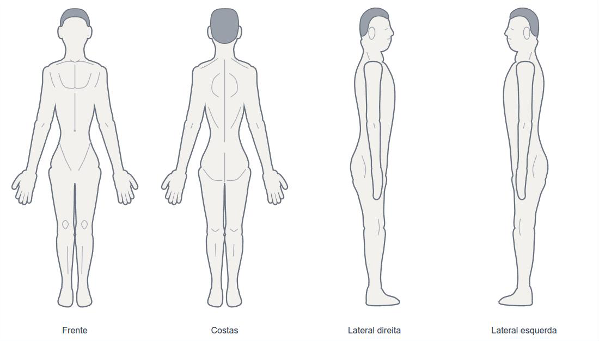

# Mapa corporal de dor — desenhos

Desenhos usados no mapa corporal de dor (FabioCarlesso/carlessopilatesfe#307, API FabioCarlesso/carlessopilatesapi#249).

## Versão 1

- Arquivos: `public/mapa-corporal/v1/frente.svg`, `costas.svg`, `lateral-direita.svg`, `lateral-esquerda.svg`.
- Desenho original do projeto, gerado por `gerar_corpo_v1.py` (`python3 scripts/mapa-corporal/gerar_corpo_v1.py <pasta-de-saida>`).
- Posição anatômica: braços levemente abertos e palmas para a frente; nas laterais o braço fica ao longo do corpo.
- Lateral direita = figura olhando para a direita da imagem (o observador vê o lado direito do paciente).

## Contrato com os pontos de dor

- Todas as vistas usam `viewBox="0 0 240 520"`.
- O ponto é gravado com `x` e `y` normalizados (0 a 1) em relação a esse retângulo e com a `vista`.
- Cada ponto guarda a `desenhoVersao` em que foi marcado (hoje, `1`).

## Como trocar os desenhos

1. Criar uma pasta nova (`public/mapa-corporal/v2/`) com os quatro arquivos, com os mesmos nomes.
2. Manter o mesmo `viewBox` (240 × 520) e o corpo ocupando a mesma área. Se a proporção mudar, os pontos antigos só
   continuam corretos sobre o desenho da versão em que foram marcados.
3. Passar a marcar os novos pontos com `desenhoVersao = 2`. Os registros antigos continuam abrindo com a versão 1,
   então a pasta `v1` não pode ser apagada.
